# logger_app : logger FPGA temps réel (architecture GLviewer)

Application PyQt6 / pyqtgraph qui configure le logger du FPGA par UDP et affiche les trames
en temps réel. Elle reprend l'organisation du **GLviewer** (modèle / contrôleurs / vue,
arborescence des voies + arbre de paramètres + graphique) sans tout ce qui concerne les
fichiers (import Graphtec/CSV, filtres, analyses, undo/redo), et suit pas à pas le
script d'origine **`logger.m`**.

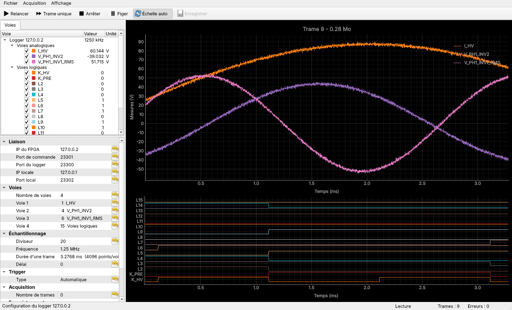

*Capture prise pendant les tests, contre le simulateur : 3 voies analogiques + 16 voies
logiques, trigger automatique.*

---

## 1. État des lieux

### `logger.m` (référence fonctionnelle)

| Fonction | Détail |
|---|---|
| Sélection port/IP du PC | `port_msg` envoyé sur le port 9 |
| Configuration | trame de 32 octets : nb de canaux, voies (4 bits chacune), diviseur, délai, trigger, masque DJ, seuil |
| Trigger | 0 auto (le PC envoie `start_msg` à chaque trame), 1 disjonction, 2 > seuil, 4 < seuil |
| Seuil | `thres`, de -32768 à 32767, comparé à la **première voie** de `sig` |
| Lecture | `trig_msg` reçu → `read_msg` → 32 datagrammes de 1030 octets (16 384 mots) |
| Nombre de trames | `frame_nb` (`inf` = infini) |
| Voies logiques | indice 15, en dernière position ; 16 bits décodés et tracés en escalier |
| Enregistrement | un fichier par trame, gains `ch_gain` appliqués |

### `logger_FPGA/` (code Python existant) : problèmes relevés

* `UDPController.acquisition_FPGA` hérite de `QThread` sans `run()` : socket et timers
  vivent dans le thread de l'interface, et tout le dialogue UDP y tourne.
* Machine à états difficile à suivre et éloignée de `logger.m` : en trigger
  disjonction/seuil, `read_msg` (puis `start_msg` sur timeout) est envoyé avant tout
  déclenchement, et `start_msg` + `read_msg` sont renvoyés sans la pause `tempo`.
* `extractData` : la matrice des gains a toujours 15 lignes alors que les données en ont
  `n` (une par voie). Le produit échoue donc dès 2, 4 ou 8 voies. Les gains valent
  `[1]*15` et la division par 16384 n'est pas faite.
* Mode logique : le champ « nombre de canaux » reçoit 15, alors que `logger.m` envoie 1
  (avec `sig = [15]`).
* Non implémentés : seuil, limitation à N trames, enregistrement, décodage des voies
  logiques.
* Dépôt encombré : `__pycache__` versionnés, `UDPController_OLD.py`, chemins Windows codés
  en dur (`'.\logger_FPGA\logger.ui'`), deux `MainWindow` concurrentes.

## 2. Solutions étudiées

**Structure de l'application**

| Option | Avantages | Inconvénients |
|---|---|---|
| A. Reprendre `logger_FPGA/` | code déjà là | architecture ancienne (QTreeWidget + `CustomItems`), bugs ci-dessus, peu testable |
| B. Brancher l'acquisition dans le GLviewer complet | toutes les fonctions d'analyse disponibles | modèle pensé pour des fichiers statiques (`FileObject`, pipeline, undo), ~27 000 lignes à maintenir, rafraîchissement temps réel coûteux |
| **C. Nouvelle application, structure GLviewer simplifiée** (retenue) | même découpage MVC et même ergonomie, code court (~1 900 lignes), testable sans matériel | les outils d'analyse restent dans le GLviewer |

**Dialogue UDP**

| Option | Commentaire |
|---|---|
| `QUdpSocket` événementiel (existant) | non bloquant, mais il faut une machine à états complète (attente du trig, comptage des paquets, délais). C'est là que le code actuel diverge de `logger.m`. |
| **socket Python bloquante dans `QThread.run()`** (retenue) | traduction ligne à ligne de la boucle `logger.m`, lisible ; délais d'attente natifs ; l'interface ne bloque jamais (signaux Qt en file d'attente) ; arrêt par drapeau vérifié toutes les 0,2 s |
| processus séparé (`multiprocessing`) | utile seulement si le décodage ou l'enregistrement saturent le GIL à très haut débit ; à garder en réserve |

**Affichage temps réel** : le FPGA peut produire plus de trames que l'écran ne peut en
afficher (≈ 13 ms par trame avec div = 20). Le contrôleur du graphique ne garde que la
dernière trame et redessine au plus 30 fois/s. Les courbes sont créées une fois par
configuration puis mises à jour par `setData`, avec le sous-échantillonnage « peak » et
`clipToView` de pyqtgraph.

## 3. Architecture

```
logger_app/
├── main.py                        point d'entrée (python main.py [config.json])
├── model/
│   ├── config.py                  LoggerConfig : paramètres, validation, JSON (ancien format accepté)
│   ├── protocol.py                trames UDP (construction / décodage), Frame
│   ├── recorder.py                enregistrement : un fichier csv (colonne trame) + .json, ou npz
│   ├── frame_buffer.py            mémoire tampon des dernières trames
│   ├── formula/                   moteur de formules du GLviewer (copie, voir son __init__)
│   ├── math_channels.py           voies calculées : fonctions temps réel, unités, évaluation
│   ├── loader.py                  relecture d'un enregistrement (.csv, .npz)
│   ├── pattern.py                 export d'un motif : sélection, décimation, formats
│   ├── scope_record.py            oscilloscope : import CSV Tektronix -> HDF5, lecture par zoom
│   ├── spectrum.py                FFT : fenêtres, amplitudes calibrées, moyennage, pics, THD
│   └── measures.py                mesures entre deux curseurs (Δt, Δy, min, max, moyenne, efficace)
├── controller/
│   ├── udp_worker.py              AcquisitionWorker(QThread) : boucle de logger.m
│   ├── acquisition_controller.py  démarrage / arrêt / relance du worker
│   ├── config_controller.py       ParameterTree <-> LoggerConfig (voie de seuil, grandeurs dérivées)
│   ├── channel_tree_controller.py arborescence des voies (visibilité, valeur sous le curseur)
│   ├── graph_controller.py        graphique temps réel (analogique + logique, seuil, curseur)
│   ├── fft_controller.py          spectre temps réel et réglages FFT
│   ├── scope_controller.py        mode enregistrement long (vue d'ensemble, zoom, import)
│   ├── recent_controller.py       fichiers récents, dernier répertoire visité
│   ├── pattern_controller.py      export d'un motif (zone, points marqués, copie)
│   ├── math_controller.py         groupe « Voies calculées » (formules, état)
│   ├── buffer_controller.py       onglet Trames : mémoire tampon, relecture, sauvegarde, confirmations
│   ├── cursor_controller.py       curseurs de mesure (t1/t2, y1/y2) et mesures associées
│   ├── detach_controller.py       graphiques déportables dans leur propre fenêtre (écran déporté)
│   └── main_controller.py         câblage des contrôleurs et de la vue
├── view/main_window.py            fenêtre : barre d'outils, arbre, paramètres, graphiques, barre d'état
├── view/detached_window.py        fenêtre d'un graphique déporté
├── view/pattern_dialog.py         fenêtre « Exporter un motif »
├── ressources/pens.py             couleurs des voies (palette tab20 du GLviewer)
├── ressources/zoom.py             limites de zoom des graphiques
├── tools/fpga_simulator.py        simulateur du FPGA (UDP local)
└── tests/                         protocole, acquisition contre le simulateur, interface hors écran
```

Flux principal :

```
ConfigController ──config_changed──> ChannelTree / LiveGraph (aperçu)
[Démarrer]  ──> AcquisitionController.start(cfg) ──> AcquisitionWorker (thread)
AcquisitionWorker ──frame_ready(Frame)──> LiveGraphController.on_frame (dernière trame)
LiveGraphController (QTimer 30 Hz) ──cursor_values──> ChannelTreeController (colonne Valeur)
ChannelTreeController ──visibility_changed──> LiveGraphController.set_visible
```

## 4. Correspondance avec `logger.m`

| `logger.m` | logger_app |
|---|---|
| `chn`, `sig` | *Voies › Nombre de voies* et *Voie 1..8* ; la voie 15 (logique) n'est proposée qu'en dernière position |
| `div` | *Échantillonnage › Diviseur*, avec fréquence et durée de trame affichées |
| `del` | *Échantillonnage › Délai* (envoyé tel quel) |
| `trig` | *Trigger › Type* : Automatique / Disjonction / > seuil / < seuil |
| `trip` | *Trigger › Masque disjonction* (hexadécimal) |
| `thres` + voie en 1re position | *Trigger › Voie de seuil* : la voie choisie est **placée en tête de la liste** ; *Seuil (brut)* ou *Seuil (physique)* (converti avec le gain de la voie) ; ligne du seuil sur le graphique ; « (seuil) » dans l'arborescence |
| `frame_nb` | *Acquisition › Nombre de trames* (0 = infini) ; bouton *Trame unique* (F6) |
| `pl` | toujours actif ; *Figer* (F8) fige l'affichage sans arrêter l'acquisition |
| `wr`, `pre`, `ch_name` | bouton *Enregistrer* (à tout moment, même pendant l'acquisition) + *Enregistrement › Dossier / Préfixe / Format* ; un seul fichier par enregistrement avec une colonne `trame`, au lieu d'un fichier par trame |
| `ch_gain` | *Description des voies › Gain (valeur à 1 pu)*, comme `ch_gain` : valeur = brut / 16384 × gain |
| `ylim` fixe | *Échelle auto* décochée : ±(multiple de 100 au-dessus du gain max) |
| `title(frame, Mo)` | titre du graphique (numéro de trame) ; compteurs de trames et d'erreurs dans la barre d'état |
| `kbhit` / clic sur la figure | bouton *Arrêter* (F7) ; `stop_msg` envoyé à l'arrêt |
| `arp-ping` | non repris : l'absence de réponse est signalée dans la barre d'état (« sans réponse »), et `start_msg` est renvoyé toutes les 2 s en trigger automatique |

Les octets de la trame de configuration sont comparés à une transcription littérale du
calcul de `logger.m` (`tests/test_protocol.py`), de même que le découpage des voies
(`reshape` + `fliplr`).

## 5. Utilisation

```bash
pip install -r requirements.txt
python main.py                       # dernière configuration utilisée
python main.py ../logger_FPGA/ressources/parametres_scope.json
```

La configuration courante est enregistrée à la fermeture (dossier de configuration de
l'utilisateur) et peut être exportée ou rechargée en JSON (menu *Fichier*). L'ancien
format `parametres_scope.json` est accepté : ses gains par point sont convertis en
valeur à 1 pu.

Graphique : un double-clic place le curseur vertical. La colonne *Valeur* de
l'arborescence donne alors la valeur de chaque voie sous le curseur (sans curseur : le
dernier point de la trame). Les cases à cocher masquent ou affichent les courbes.

### Mémoire tampon et navigation dans les trames

Comme dans PicoScope 7, les **dernières trames reçues restent en mémoire**, même sans
enregistrement : 64 par défaut, réglable dans *Mémoire tampon › Trames gardées*. La
mémoire nécessaire est affichée : de 160 à 230 ko par trame selon les voies, soit 10 à
15 Mo pour 64 trames (maximum réglable : 5 000 trames).

* **Onglet Trames**, à côté de l'onglet Voies : une ligne par trame, avec une vignette
  de la première voie, son numéro, son heure de capture, et ✓ si elle est enregistrée sur
  disque. Le compteur indique les trames en mémoire et celles qui ne sont pas encore
  enregistrées.
* **Relecture** : un clic sur une trame l'affiche. Graphiques, FFT, curseurs et
  valeurs de l'arborescence suivent. Le titre indique « mémoire tampon ». L'acquisition
  continue en arrière-plan et la mémoire tampon se remplit, mais l'affichage reste sur la
  trame choisie. Si elle sort de la mémoire tampon pendant la relecture, elle reste
  affichée et c'est signalé.
* **Navigation** : *Trame précédente* (Alt+←), *Trame suivante* (Alt+→), *Direct*
  (Alt+Fin). Ces raccourcis sont aussi actifs dans les fenêtres déportées. Depuis le
  direct, Alt+← affiche l'avant-dernière trame. Après la dernière, Alt+→ revient au
  direct.
* **Numérotation** : les numéros continuent d'une acquisition à l'autre, chaque trame a
  donc un numéro unique, dans la mémoire tampon comme dans les fichiers.
* **Sauvegarde** : *Fichier › Enregistrer la mémoire tampon...* (Ctrl+Maj+S, ou bouton
  de l'onglet) enregistre toutes les trames dans un seul fichier. Le menu contextuel de
  la liste enregistre seulement la sélection (Ctrl/Maj+clic).
* **Avant de quitter**, s'il reste des trames non enregistrées, l'application propose
  *Enregistrer*, *Ne pas enregistrer* ou *Annuler*. Même question avant une acquisition
  avec une autre disposition de voies (voies ou diviseur différents) : elle vide la
  mémoire tampon, car toutes ses trames doivent pouvoir être affichées par le même
  graphique et enregistrées dans le même fichier.

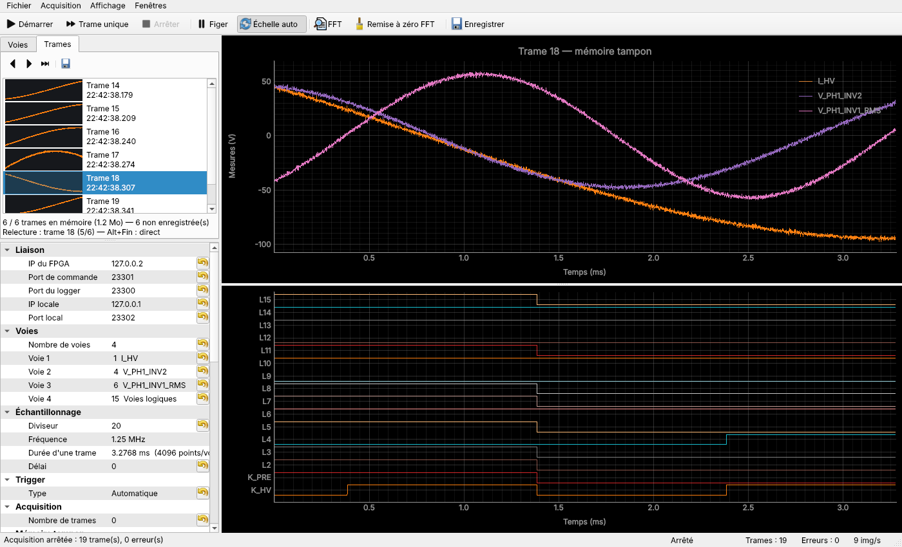

### Enregistrement des trames

**Format** : un seul fichier par enregistrement (auparavant, un fichier par trame).

```
enr_I_HV_V_PH1_INV2_Logic_div_20_20261103-143012.csv
trame,temps_s,I_HV (V),V_PH1_INV2 (V),K_HV,K_PRE,L2,...
12,0,57.31,-12.08,0,1,0,...
12,8e-07,57.42,-12.11,0,1,0,...
...
13,0,...
```

* `trame` : numéro de la trame (le même que dans le titre du graphique et dans l'onglet
  Trames) ; `temps_s` : temps depuis le début de la trame.
* À côté, `<même nom>.json` décrit l'enregistrement : configuration complète (voies,
  gains, diviseur, trigger…), fréquence d'échantillonnage et, pour chaque trame, son
  numéro et son heure de capture.
* Le CSV est écrit au fil de l'eau : il reste lisible même si l'application s'arrête
  brutalement.
* Le format npz contient les mêmes données en tableaux numpy (`trame`, `timestamp`,
  `time`, `analog` [trames × points × voies], `logic`, `raw`). Il est écrit à la fin de
  l'enregistrement.
* Un fichier existant n'est jamais écrasé (suffixe `_2`, `_3`…).

**Bouton Enregistrer**

* **Pendant l'acquisition**, il ouvre un fichier et y ajoute chaque trame dès la
  suivante. Un second clic ferme le fichier. La barre d'état affiche « ● REC ».
* **À l'arrêt**, il arme l'enregistrement pour le prochain *Démarrer* ou la prochaine
  *Trame unique*.
* **Dossier** : par défaut `Documents/LoggerFPGA`, modifiable dans *Enregistrement ›
  Dossier* ; *Acquisition › Ouvrir le dossier d'enregistrement* l'affiche.
* **En cas d'erreur** (dossier non accessible en écriture, disque plein…), un message
  s'affiche et le bouton se décoche. L'acquisition continue sans enregistrer.

Les trames enregistrées par ce bouton sont marquées ✓ dans la mémoire tampon : elles ne
sont pas proposées à nouveau avant de quitter.

### Exporter un motif (table de points pour un simulateur)

Pour reprendre une forme d'onde mesurée dans PLECS, PSPICE, LTspice ou un tableur :
**clic droit sur le graphique** des voies analogiques (ou des voies calculées) ›
**Exporter un motif...**

* Une **zone orange** (`LinearRegionItem`, comme la zone FFT) apparaît au milieu de la
  portion affichée. On la déplace, on tire ses bornes, ou on saisit *Début* / *Fin* dans
  la fenêtre *Exporter un motif*, qui reste ouverte pendant ce réglage.
* Les **points exportés sont marqués** sur la courbe de la voie choisie (points orange) :
  on voit directement l'effet de la décimation.
* **Voie** : analogique, calculée ou logique (créneau 0/1, utile pour une commande PWM).
* **Points max** : 2 000 au plus. Au-delà, l'export garde 1 point sur N, ainsi que le
  premier et le dernier échantillon de la zone. La fenêtre indique le nombre
  d'échantillons de la zone, le pas et le nombre de points exportés.
* **Formats** :

  | Format | Contenu | Pour |
  |---|---|---|
  | Colonnes (tabulation) | `t (s)⇥voie (unité)` puis une ligne par point | tableur, PLECS (copier-coller) |
  | CSV (;) | idem, séparateur `;` | tableur |
  | PWL (PSPICE, LTspice) | `t y` par ligne, sans en-tête | source `PWL(file=...)` |
  | Vecteurs (PLECS, MATLAB) | `t = [...];` et `voie = [...];` | champs d'une *1D Look-Up Table* |

  *Temps relatif au début du motif* (coché par défaut) : le motif commence à t = 0.
  *Virgule décimale* : pour un tableur français (sans effet sur PWL et Vecteurs, qui
  exigent le point).
* **Copier** met le texte dans le presse-papiers. **Enregistrer...** l'écrit dans un
  fichier, proposé dans le dernier répertoire. Un aperçu montre les premières lignes.
* **Enregistrement d'oscilloscope** : comme pour la FFT sur zone, le motif est lu en
  données brutes dans le fichier, quel que soit le zoom. On peut donc choisir le motif
  sur l'enveloppe de tout l'enregistrement. Les voies calculées sont évaluées sur la
  zone : une intégrale y part du début de la zone.
* Pendant un glisser, la mise à jour se fait au relâchement. En direct (logger), le
  motif suit la trame affichée : *Figer* (F8) le fige.
* Fermer la fenêtre retire la zone et les points du graphique.

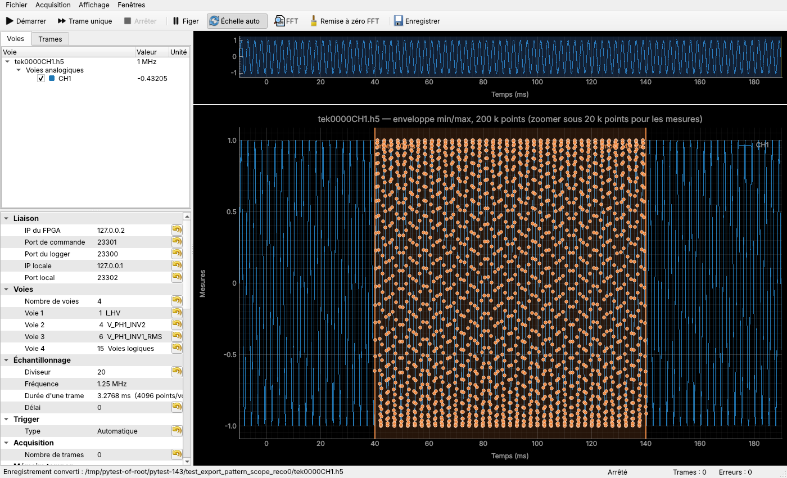
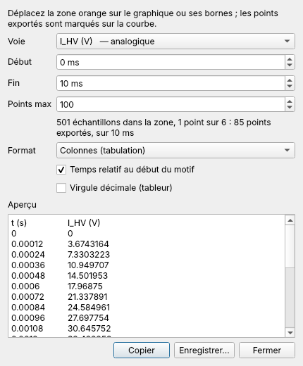

### Limites de zoom

Comme dans le GLviewer (`PlotPanel.update_zoom_limits`), chaque graphique est borné
(`ViewBox.setLimits`, `ressources/zoom.py`). Sans ces bornes, la molette dézoomait
jusqu'à des plages de 10³⁰. pyqtgraph échouait alors (« Maximum allowed dimension
exceeded » dans le sous-échantillonnage, glyphes et QPainter inutilisables sous Windows).

| Graphique | Dézoom maximal | Zoom maximal |
|---|---|---|
| Temps (voies analogiques, calculées, logiques) | trame ou enregistrement entier + 5 % | 10 échantillons |
| Valeurs (voies analogiques, calculées) | valeurs des courbes visibles + 25 % de chaque côté | 10⁻⁶ de l'étendue des valeurs |
| Voies logiques | les 16 niveaux | — (axe vertical fixe) |
| FFT, fréquences | 0 à fs/2 (en décades en échelle log) + 5 % | 4 raies (0,01 décade en log) |
| FFT, amplitudes | valeurs affichées + 25 % | 10⁻⁶ de l'étendue |

* Les limites des valeurs suivent chaque trame affichée et les cases de l'arborescence
  (une voie masquée n'élargit pas le dézoom). Elles incluent aussi la ligne de seuil et,
  avec *Échelle auto* décochée, l'échelle fixe de `logger.m`.
* Le zoom maximal en valeurs est relatif à l'étendue, et non fixé à 0,01 comme dans le
  GLviewer, pour pouvoir zoomer sur des signaux d'oscilloscope en mV.
* Les limites de temps sont posées sur chacun des trois panneaux temporels : pyqtgraph
  ne les transmet pas par le lien des axes, et le dézoom fait sur le panneau des voies
  calculées ou logiques leur échappait.

### Fichiers récents et dernier répertoire

Sur le modèle du menu *Recent files* du GLviewer :

* **Fichier › Fichiers récents** liste les 10 derniers fichiers chargés avec succès, le
  plus récent en tête et sans doublon, avec leur type :
  * **logger** : relecture dans la mémoire tampon ;
  * **oscilloscope** : c'est le workspace `.h5` qui est retenu, avec les voies ajoutées,
    pour une réouverture immédiate sans nouvelle conversion ;
  * **configuration**.
* Un clic rouvre le fichier comme il avait été chargé. Les touches 1 à 9 et 0 servent de
  raccourcis dans le menu, et l'info-bulle donne le chemin complet. Un fichier disparu
  est signalé et retiré de la liste. *Effacer la liste* vide le menu.
* **Dernier répertoire** : c'est le dossier du dernier fichier chargé. Pour un
  enregistrement d'oscilloscope, c'est celui des CSV choisis (ou des voies ajoutées),
  pas celui du `.h5`. Les boîtes d'ouverture s'y ouvrent : *Ouvrir un
  enregistrement...*, *Ajouter des voies...*, *Ouvrir une configuration...* (et
  *Enregistrer la configuration...*). Avant tout chargement, ou si ce dossier n'existe
  plus, elles s'ouvrent sur le dossier d'enregistrement.
* La liste et le répertoire sont conservés d'une session à l'autre (réglages de
  l'application, QSettings).

### Relire un enregistrement

*Fichier › Ouvrir un enregistrement...* (Ctrl+Maj+O, ou bouton de l'onglet Trames)
recharge les trames d'un fichier écrit par le logger dans la mémoire tampon. Elles se
relisent alors comme des trames capturées : vignettes, navigation Alt+←/→, graphiques,
FFT, curseurs, voies calculées. Le titre du graphique et l'onglet Trames indiquent le
fichier d'origine.

* **Formats** : CSV avec colonne `trame` (format actuel), npz, et CSV de l'ancien format
  (un fichier par trame, colonne `time_s`).
* **Configuration** : voies, noms, gains, unités et diviseur sont lus dans le `.json`
  écrit à côté du fichier. Sans lui, ils sont reconstitués depuis l'en-tête du CSV : les
  voies sont alors renumérotées 0, 1, 2… et l'heure de capture est inconnue.
* **Affichage** : graphiques et arborescence prennent la configuration du fichier.
  L'arbre des paramètres garde celle de l'acquisition, qui n'est pas modifiée par
  l'ouverture d'un fichier.
* **Mémoire tampon** : le fichier la remplace. Si elle contient des trames non
  enregistrées, l'application propose de les enregistrer d'abord (question posée
  seulement si le fichier est lisible). Elle est agrandie si le fichier contient plus de
  trames que *Trames gardées* (5 000 au plus).
* **Trames relues** : elles sont marquées ✓ (déjà sur disque) et ne sont pas proposées
  à l'enregistrement en quittant. L'acquisition suivante numérote ses trames après
  celles du fichier.
* **Pendant une acquisition**, l'ouverture est refusée : il faut d'abord l'arrêter (F7).

Lecture : environ 0,5 s pour 64 trames (21 Mo de CSV).

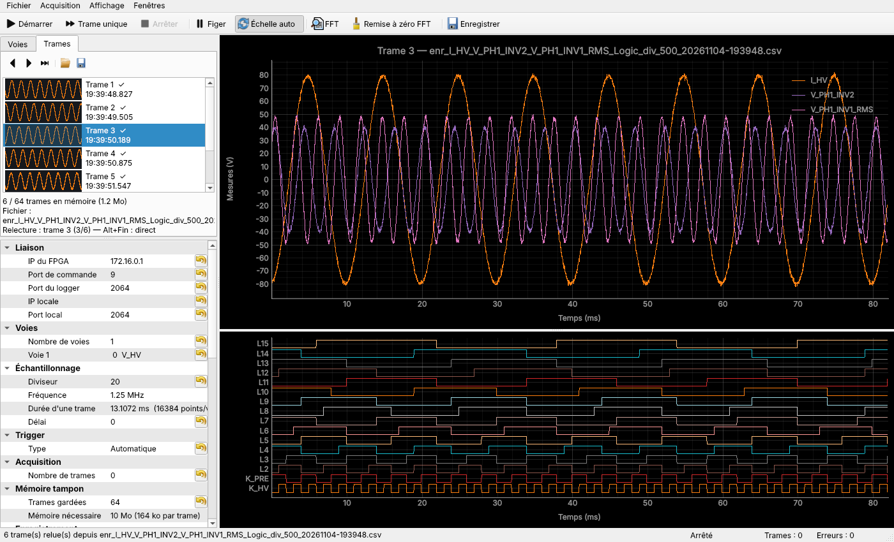

### Enregistrements longs d'oscilloscope (Tektronix)

Le même outil sert à parcourir les enregistrements d'oscilloscope (DPO7054…), qui font
plusieurs millions de points par voie. *Fichier › Ouvrir un enregistrement...* reconnaît
le type de fichier :

| Fichier | Effet |
|---|---|
| CSV du logger (`trame,temps_s,...`), npz | relecture dans la mémoire tampon (section précédente) |
| CSV Tektronix (un ou plusieurs) | conversion en HDF5, puis mode enregistrement long |
| `.h5` (logger ou `csv_to_hdf5.py` de HDF5_viewer) | mode enregistrement long |

**Format CSV Tektronix.** Les données commencent dès la ligne 0 : colonnes 0 à 2 pour
les métadonnées des premières lignes (`Record Length`, `Sample Interval`, `Trigger
Point`, `Trigger Time`, `Horizontal Offset`), colonne 3 pour le temps, colonnes 4, 5…
pour les signaux. Noms des voies (même règle que `csv_to_hdf5.py`) : les lignes de
métadonnées supplémentaires, une par voie dans l'ordre des colonnes, sinon CH1, CH2….

**Un fichier par voie (Tektronix).** L'oscilloscope écrit un CSV par voie. Deux façons
de les réunir dans un même enregistrement :
* **les choisir ensemble** dans *Ouvrir un enregistrement...* (Ctrl+clic ou Maj+clic,
  comme l'indique le titre de la boîte de dialogue) : un seul `.h5` est créé
  (`<premier fichier>_voies.h5`) ;
* **les ajouter au fur et à mesure** : *Fichier › Ajouter des voies à
  l'enregistrement...*, ou simplement *Ouvrir un enregistrement...* sur un enregistrement
  déjà affiché, puis **Ajouter les voies** (ou **Remplacer**, ou *Annuler*). Un `.h5`
  peut aussi être ajouté : ses voies sont copiées avec leur pyramide. La portion affichée
  est conservée.

Les voies réunies doivent venir de la même acquisition : même intervalle
d'échantillonnage, même nombre de points, même premier instant. Sinon l'ajout est refusé
avec un message, et l'enregistrement reste inchangé. L'ajout s'écrit dans une copie du
`.h5`, qui ne remplace l'original qu'en cas de succès : une annulation ou une erreur ne
l'abîme pas.

Noms des voies : `CHn` tiré du nom de fichier (`tek0000CH2.csv` → CH2), sinon le nom du
fichier ; un nom déjà pris reçoit un suffixe (`CH2_2`). Les lignes de noms dans les
métadonnées, s'il y en a une par voie, restent prioritaires.

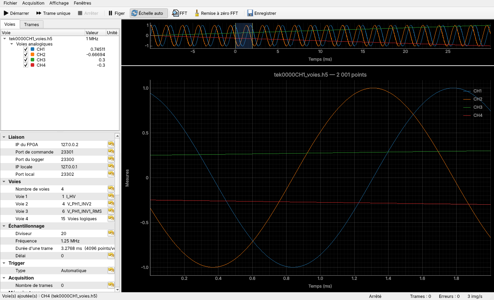

**Conversion en HDF5.** Elle a lieu une seule fois, en arrière-plan, avec une barre de
progression annulable. Le `.h5` est écrit à côté du CSV et réutilisé tant qu'il est plus
récent que lui. Sa structure est celle de HDF5_viewer (`/signals/<voie>/raw/value`,
`overview`, `pyramid/level_XX` min/max) : les deux outils lisent les fichiers l'un de
l'autre (vérifié dans les deux sens). Lecture du CSV par blocs avec numpy, sans pandas :
environ 4 s pour 5 millions de points sur 2 voies, soit une vingtaine de secondes pour
25 M. Le HDF5 est environ 3 fois plus petit que le CSV.

**Navigation.**
* Une **vue d'ensemble** de tout l'enregistrement s'affiche au-dessus des graphiques.
  Sa zone bleue correspond à la portion affichée : on peut la déplacer ou l'élargir, et
  elle suit aussi les zooms faits sur le graphique.
* À chaque zoom ou déplacement, la portion visible est relue dans le HDF5 (1 à 20 ms) :
  * **jusqu'à 2 millions de points par voie : données brutes**. Curseurs et *Mesures*,
    FFT, voies calculées et valeurs de l'arborescence fonctionnent comme sur une trame du
    logger, avec les temps réels de l'enregistrement ;
  * **au-delà : enveloppe min/max** tirée de la pyramide. Les pics isolés restent
    visibles, mais FFT, voies calculées et *Mesures* sont suspendues, avec le message
    « zoomer jusqu'aux données brutes ».
* Le titre du graphique indique le fichier et le nombre de points affichés.
* Temps de réaction mesurés, relecture, calculs et dessin compris (FFT et une voie
  calculée actives) : 0,15 à 0,2 s jusqu'à 200 000 points, environ 0,9 s à 2 millions de
  points bruts.

**Retour au logger.** *Fichier › Fermer l'enregistrement d'oscilloscope*, *Démarrer*, ou
un clic sur une trame de l'onglet Trames : l'affichage revient à la configuration du
logger. La mémoire tampon n'est pas touchée par l'ouverture d'un enregistrement
d'oscilloscope.

Dépendance : `h5py`.

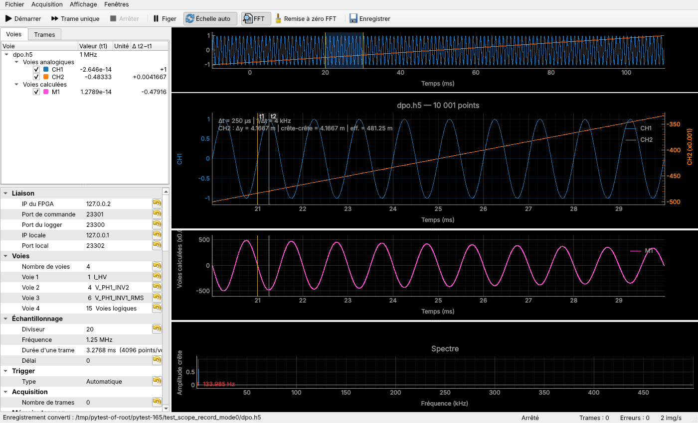

### Voies calculées (MATH)

Comme les voies MATH d'un oscilloscope : des formules sur les voies de chaque trame,
recalculées en temps réel et en relecture de la mémoire tampon. Groupe **Voies
calculées** de l'arbre des paramètres : *Ajouter une voie calculée*, puis *Nom*,
*Formule*, *Unité* (vide : déduite de la formule), *Affichée*, *État*, *Supprimer*
(8 voies au plus).

```
P_INV1     [V_PH1_INV1]*[I_PH1_INV1]        unité déduite : W (si V et A sont renseignées)
I_moy      movavg([I_HV]; 64)               moyenne glissante sur 64 points
dV/dt      deriv([V_HV])                    V/s
I_eff      rms([I_HV])                      valeur efficace de la trame (droite horizontale)
ET         [K_HV]*[K_PRE]                   combinaison de voies logiques (0/1)
Pmoy       avg([P_INV1])                    réutilise une voie calculée définie plus haut
```

* **Voies** : `[nom]` (analogique ou logique, espaces admis), `A0`…`A14` par numéro,
  `L0`…`L15` par bit, `[voie calculée]` définie plus haut dans la liste, `time` (temps
  depuis le début de la trame, en s). L'entrée *Voies et fonctions* du groupe les liste
  pour la configuration courante.
* **Fonctions du GLviewer** : `sin cos tan exp log` (népérien) `log10 sqrt abs` ;
  `max min sum avg` (un argument : valeur sur la trame ; plusieurs : point par point) ;
  tables `steps` et `interp` ; propriétés de l'eau et de l'air. Les arguments sont séparés
  par `;`.
* **Fonctions ajoutées pour les trames** : `deriv(x)`, `integ(x)` (depuis le début de la
  trame), `movavg(x; n)` (moyenne glissante centrée), `rms(x)`, `pkpk(x)`.
* **Affichage** : panneau *Voies calculées* entre les voies analogiques et logiques, avec
  le même axe des temps, déportable comme les autres. Les voies calculées apparaissent
  aussi dans l'arborescence (visibilité, valeur sous le curseur, Δ entre t1 et t2), et les
  curseurs t1/t2 traversent ce panneau.
* **Réactivité** : chaque modification est appliquée tout de suite, même pendant
  l'acquisition. L'*État* indique l'unité obtenue (✓ W), une formule invalide ou une voie
  inconnue, et les erreurs de calcul sur la trame affichée (division par zéro…).
* **Configuration** : les définitions sont enregistrées avec elle (JSON, dernière
  configuration utilisée).

**Moteur** : celui du GLviewer (`model/formula`, lexer → parser → arbre → interpréteur
numpy, analyse des unités), copié sans modification à l'exception de `errors.py`. Les
ajouts propres au logger (fonctions qui ont besoin de la fréquence d'échantillonnage,
unités lisibles comme V², V·A, V/s) sont dans `model/math_channels.py`, par sous-classes,
pour pouvoir reprendre telles quelles les évolutions du GLviewer. Les tests du moteur du
GLviewer sont repris dans `tests/glviewer_formula`. Coût mesuré : moins de 0,2 ms par
formule et par trame de 16 384 points.

Limites actuelles : la FFT et les *Mesures* des curseurs portent sur les voies
analogiques seulement, et les voies calculées ne sont pas écrites dans les fichiers
d'enregistrement.

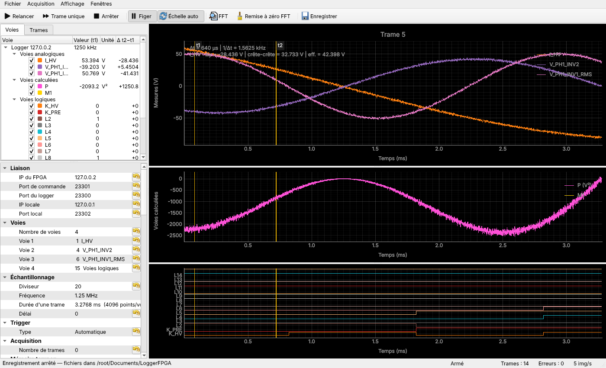

### Curseurs de mesure

Groupe *Curseurs* de l'arbre des paramètres, sur le modèle des curseurs du GLviewer
(*Cursors menu* : Waveform, barres horizontales, verticales, H&V). *Type* propose
**Aucun**, **Verticaux**, **Horizontaux** ou **Verticaux + horizontaux**.

* **Curseurs verticaux t1 / t2** : deux lignes à faire glisser, présentes sur le
  panneau analogique comme sur le panneau logique (positions liées). Les champs *t1* et
  *t2* sont liés aux lignes dans les deux sens, et *Δt* et *1/Δt* sont affichés. Dans
  l'arborescence, la colonne *Valeur (t1)* donne la valeur de chaque voie en t1, et la
  colonne *Δ t2−t1* son écart y(t2) − y(t1). Pour une voie logique, cet écart vaut
  +1, 0 ou −1 : changement d'état entre les curseurs.
* **Curseurs horizontaux y1 / y2** : deux niveaux sur le panneau analogique, avec leur
  écart *Δy*.
* **Mesures** sur la *voie de mesure*, entre t1 et t2 : y(t1), y(t2), Δy, pente
  Δy/Δt, min, max, crête-crête, moyenne, valeur efficace, nombre d'échantillons. On
  choisit la voie dans le groupe ou en cliquant sur la voie dans l'arborescence.

Les valeurs sont celles de l'échantillon le plus proche de chaque curseur (curseur
« magnétique »). Un résumé (Δt, Δy, mesures) s'affiche en haut à gauche du graphique.
Les mesures suivent chaque nouvelle trame et restent figées avec *Figer*. Sans curseurs
verticaux, le double-clic place toujours le curseur simple.

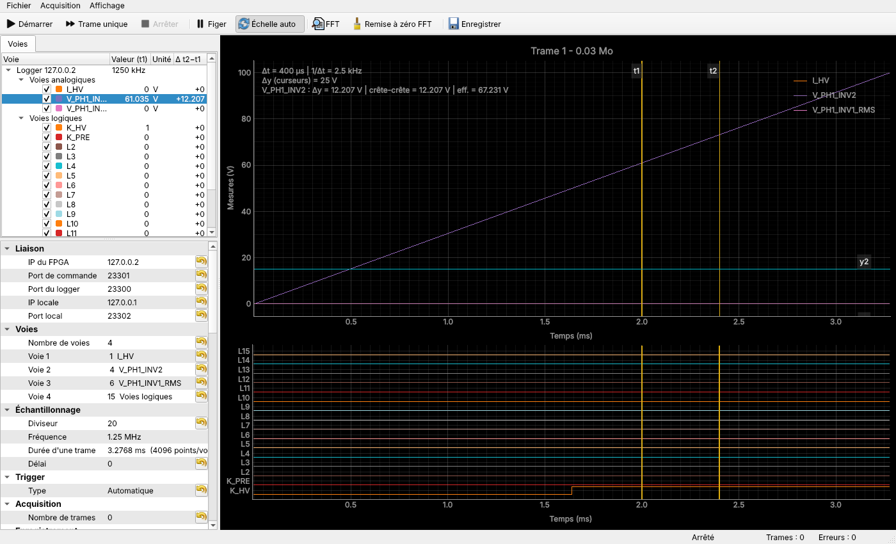

### Écran déporté

Chaque graphique peut être placé dans sa propre fenêtre, par exemple sur un deuxième
écran : **voies analogiques**, **voies logiques** et **spectre (FFT)**. Le graphique
temporel est découpé en deux widgets, avec les axes de gauche à largeur fixe pour garder
les échelles des temps alignées.

* Pour déporter : clic droit sur le graphique, puis *Déporter dans une fenêtre*. On peut
  aussi passer par le menu **Fenêtres** (une case par graphique, et *Tout réintégrer*).
* Pour réintégrer : fermer la fenêtre, ou clic droit puis *Réintégrer dans la fenêtre
  principale*. Le graphique revient à sa place d'origine.
* Les raccourcis F5 à F9 (Démarrer, Trame unique, Arrêter, Figer, FFT) restent actifs
  dans les fenêtres déportées.
* La fenêtre suit l'état du graphique. Si on décoche *FFT*, la fenêtre du spectre est
  masquée, puis réaffichée quand on la recoche. Une configuration sans voie logique (ou
  sans voie analogique) masque de même le panneau correspondant.
* Position et taille des fenêtres, ainsi que l'état déporté, sont conservés d'une session
  à l'autre (QSettings).
* Quand tous les graphiques sont déportés, la fenêtre principale affiche un message à
  leur place.

Repris du GLviewer (`view/detached_graph_window.py`, `GraphController.detach_panel`) : la
fenêtre dédiée, la réintégration à la fermeture, l'entrée du menu contextuel, le retour à
la place d'origine. Différence : le GLviewer déplace le `PlotItem` d'une scène pyqtgraph
à une autre, ce qui l'oblige à corriger les textes restés liés à l'ancienne scène
(`_release_scene`). Ici c'est le widget graphique entier qui change de fenêtre. Sa scène,
les connexions souris, les curseurs et les étiquettes le suivent donc sans traitement
particulier. Pour rendre un nouveau graphique déportable, il suffit d'un appel à
`DetachController.register(clé, titre, widget, [tracés])`.

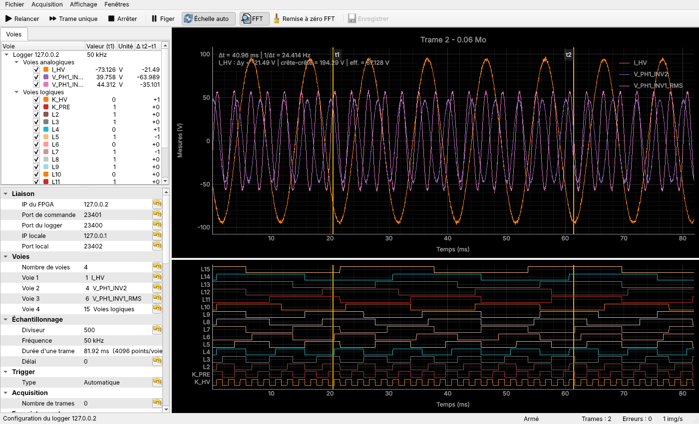

### FFT

Le bouton **FFT** (F9) affiche le spectre des voies analogiques sous le graphique
temporel. Il est calculé à chaque trame reçue, pour que le moyennage porte sur toutes les
trames et pas seulement sur celles qui sont dessinées. Réglages dans le groupe *FFT* de
l'arbre des paramètres :

| Réglage | Choix |
|---|---|
| Fenêtre | rectangulaire, hann, hamming, blackman, blackman-harris, flattop (amplitudes exactes même entre deux raies) |
| Retirer le continu | soustrait la moyenne de la trame avant la FFT |
| Échelle | amplitude crête, efficace, ou dB (réf. 1 unité crête) |
| Moyennage | aucun, moyenne des puissances des N dernières trames, maximum ; *Remise à zéro FFT* recommence |
| Fréquence max | limite haute de la zone affichée (0 : moitié de la fréquence d'échantillonnage) |
| Axe des fréquences | **Linéaire** ou **Logarithmique** (voir ci-dessous) |
| Voie analysée | voie des mesures ; un clic sur une voie de l'arborescence la sélectionne aussi |
| Pics repérés, harmoniques | nombre de pics marqués (20 dB au moins au-dessus du bruit), harmoniques prises dans le THD |

**Zone de calcul.** *Zone de calcul* (groupe FFT) propose deux modes :
* **Trame affichée** : comportement d'origine, le spectre porte sur toute la trame (ou
  toute la portion affichée d'un enregistrement d'oscilloscope) ;
* **Zone sélectionnée** : le spectre porte sur la zone verte du graphique des voies
  analogiques. Ce `LinearRegionItem` est le même élément que la sélection de plage du
  modèle thermique du GLviewer, mais la zone reste en place et le spectre suit ses
  déplacements. Ses bornes sont étiquetées (« FFT 60 ms »).
  * **Réglage** : déplacer toute la zone, tirer une borne, ou saisir *Début de zone* et
    *Fin de zone*. *Zone = portion affichée* la cale sur le zoom courant ; c'est aussi sa
    position la première fois qu'on choisit ce mode.
  * **Recalcul** : jamais pendant un glisser à la souris (de la zone ou d'une borne,
    même avec des pauses) : un seul calcul au relâchement. Les bornes affichées suivent
    le glisser en continu. Pour une saisie de *Début* / *Fin de zone*, le calcul a lieu
    100 ms après le dernier changement, et non à chaque caractère. Une zone déjà calculée
    ne l'est pas une seconde fois. La moyenne ou le maximum recommence à chaque
    changement de zone. Le titre du spectre et l'entrée *Zone* indiquent la durée et le
    nombre de points (16 au moins).
  * **Logger** : la zone découpe chaque trame, en direct comme en relecture.
  * **Enregistrement d'oscilloscope** : la zone est lue dans le fichier, en données
    brutes, **quel que soit le zoom**. On peut donc choisir une zone sur l'enveloppe de
    tout l'enregistrement et obtenir la FFT des points réels (4 millions de points par
    voie au plus, sinon un message demande de réduire la zone). Zoomer ou se déplacer
    ensuite ne relit pas et ne recalcule pas le spectre.

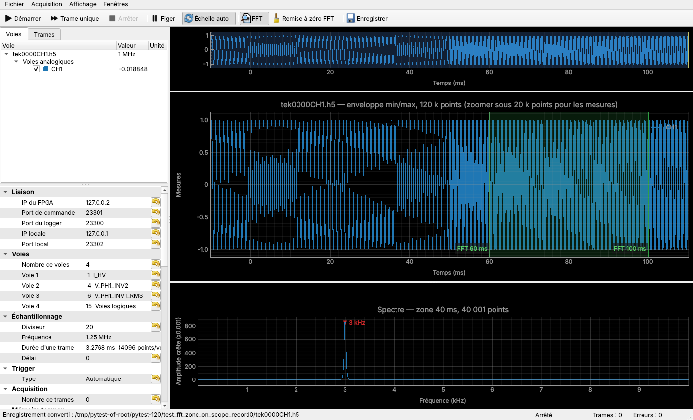

**Axe des fréquences linéaire ou logarithmique** : un seul réglage, accessible de trois
façons qui restent synchronisées :
- *Axe des fréquences* dans le groupe FFT ;
- clic droit sur le spectre, *Fréquences en échelle log* ;
- l'option *Log X* de pyqtgraph (clic droit, *Plot Options › Transforms*).

En échelle log, l'axe va de la résolution (première raie après le continu) jusqu'à la
fréquence max, avec des graduations aux décades écrites avec leur unité (10 Hz, 100 Hz,
1 kHz…) et des repères à 2 et 5. Le choix est conservé d'une session à l'autre. *Log Y*
de pyqtgraph est désactivé : marqueurs et mesures ne le suivraient pas, et l'échelle dB
joue ce rôle.

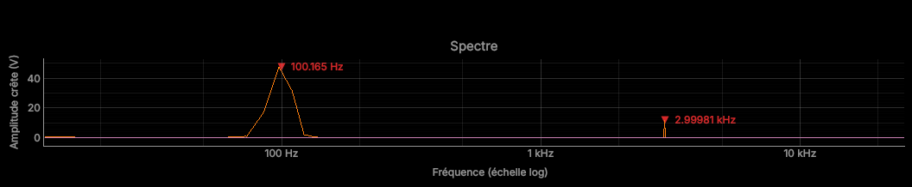

*Mesures* (lecture seule) : résolution et bande équivalente de bruit, nombre de trames
moyennées, fondamental (fréquence affinée par interpolation, amplitude), THD et liste des
pics. La valeur sous la souris est affichée au-dessus du spectre. *Figer* et les cases de
l'arborescence s'appliquent aussi au spectre.

Repris du GLviewer (`model/analysis/fft.py`) : le principe fenêtre + demi-spectre. Son
code dépend de son modèle (`AnalysisNode`, `DerivedSignalObject`) et ne calibre pas les
amplitudes, d'où le module autonome `model/spectrum.py`. Ce module pourrait en retour
servir au GLviewer.

La résolution vaut fréquence d'échantillonnage / points par voie : pour séparer des
composantes à 50 Hz, augmenter le diviseur (par exemple 500, soit 50 kHz, donne 12 Hz
avec 4 voies).

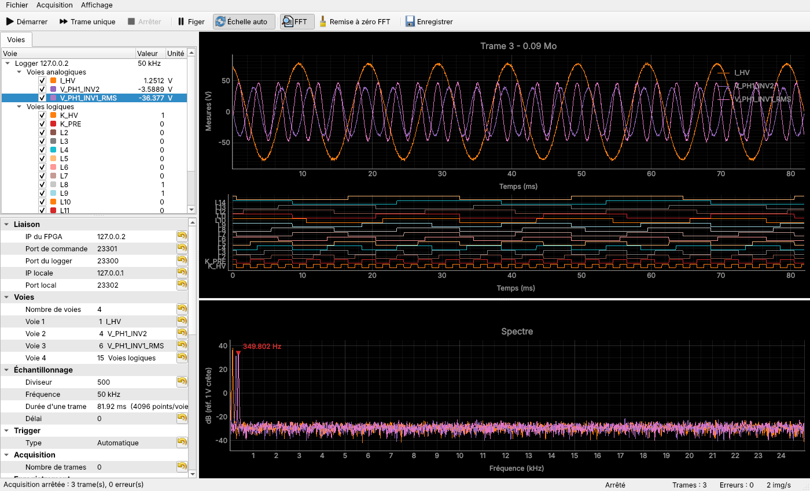

### Sans carte : simulateur

```bash
python -m tools.fpga_simulator --ip 127.0.0.2 --cmd-port 9009
```

Dans l'application : IP du FPGA `127.0.0.2`, port de commande `9009`, IP locale
`127.0.0.1`. Le simulateur gère les quatre types de trigger. En seuil, la première voie
doit vraiment franchir le seuil pour déclencher. `--drop-rate 0.05` simule des pertes de
paquets.

### Tests

```bash
pip install -r requirements-dev.txt
python -m pytest
```

211 tests (dont 92 repris du moteur de formules du GLviewer) : protocole (octet par octet contre `logger.m`), FFT, curseurs, écran déporté, enregistrement, mémoire tampon, voies calculées, relecture des enregistrements, enregistrements d'oscilloscope, fichiers récents, FFT sur zone, limites de zoom, export de motifs, acquisition complète contre le
simulateur (trigger auto, seuil, pertes, arrêt, enregistrement), interface hors écran.

## 6. Points à valider sur la carte et pistes

* **À valider sur le FPGA** : le sens du *délai* (pré/post-trigger ?) pour décaler l'axe
  des temps ; le contenu des octets 2 à 5 des datagrammes de données (numéro de paquet ?)
  pour réordonner les paquets plutôt que de les prendre dans l'ordre d'arrivée.
* Persistance : superposer les N dernières trames (mode oscilloscope).
* Relire les enregistrements dans le GLviewer. Son import « .csv » attend le format de
  l'automate du chiller (colonnes X/Y alternées) : il faut un format d'export adapté ou un
  chargeur dédié, par exemple via l'assistant d'import texte.
* Une fois validée sur la carte, cette application peut remplacer `logger_FPGA/`
  (l'ancien code est laissé intact sur cette branche).
